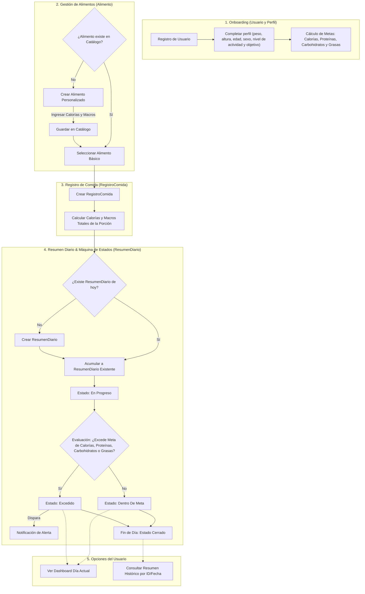
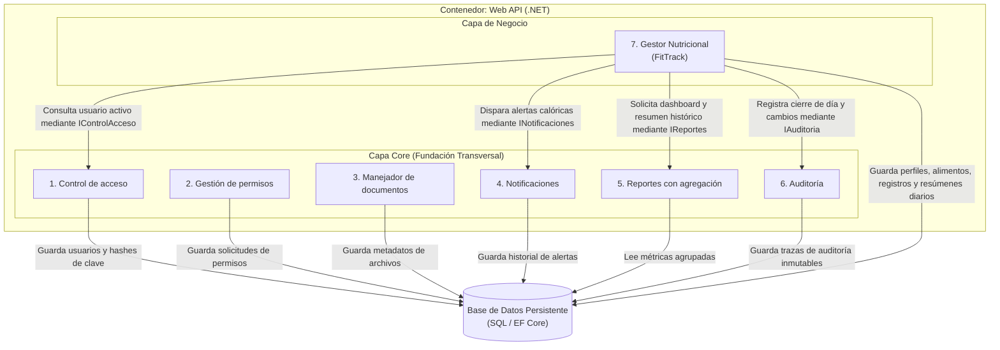
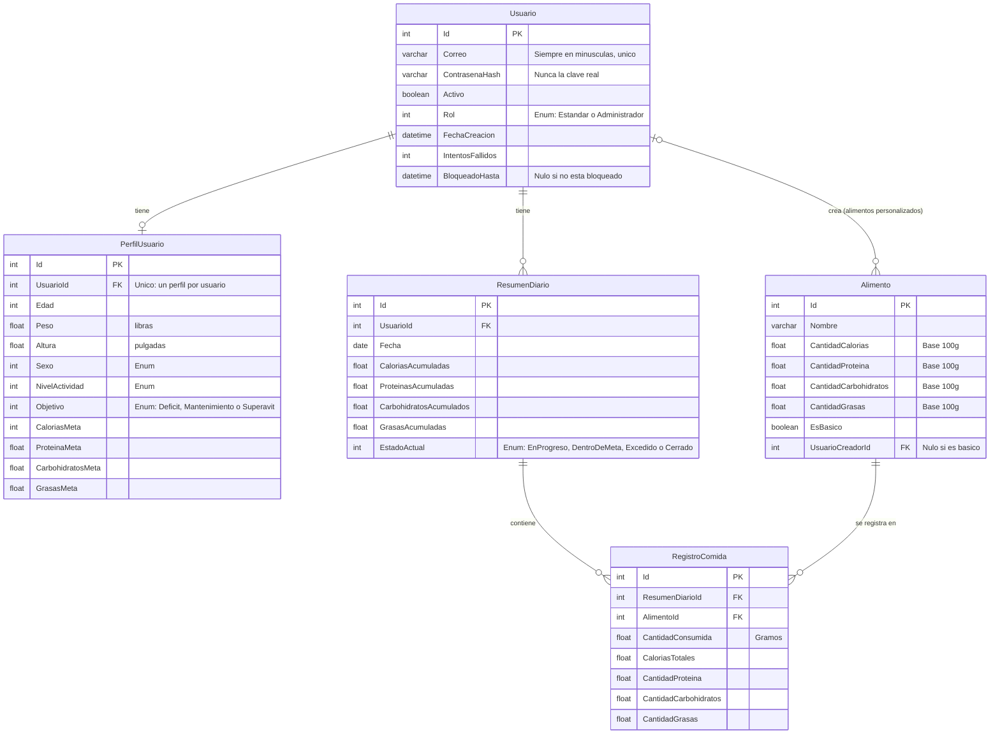

## FitTrack

**FitTrack** es un gestor de calorías y macronutrientes diseñado para brindar un control claro y preciso sobre la alimentación diaria. El sistema evalúa y calcula metas calóricas y de macronutrientes (proteínas, carbohidratos y grasas) personalizadas a partir de los datos del perfil del usuario (peso, altura, edad, sexo, nivel de actividad y objetivo nutricional: déficit, superávit o mantenimiento).

A través de un catálogo interactivo de alimentos —que integra opciones predeterminadas e ítems personalizados—, FitTrack permite registrar las porciones consumidas durante el día. El sistema consolida los datos en tiempo real, alerta mediante notificaciones cuando se alcanza o supera el tope diario, y ofrece un panel de control para consultar el consumo actual y el historial.

---

## Entidades Principales
* **Usuario:** Representa la cuenta de acceso: correo, contraseña (almacenada como hash), rol y estado de la cuenta.
* **PerfilUsuario:** Almacena los datos antropométricos y de estilo de vida del usuario (edad, peso, altura, sexo y nivel de actividad), su objetivo nutricional y las metas calculadas de calorías y macronutrientes.
* **Alimento:** Catálogo de insumos nutricionales (básicos y personalizados) con sus valores de calorías, proteínas, carbohidratos y grasas.
* **RegistroComida:** Asocia un alimento y su porción consumida al día en curso, calculando los valores nutricionales aportados.
* **ResumenDiario:** Acumula el consumo diario del usuario y gestiona el estado del día (*En Progreso, Dentro de Meta, Excedido, Cerrado*).

---

## Tecnologías Utilizadas
* **Lenguaje:** C#
* **Framework:** .NET 10 | ASP.NET Core
* **Acceso a Datos (ORM):** Entity Framework Core 10
* **Base de Datos:** Microsoft SQL Server
* **Hash de contraseñas:** BCrypt.Net-Next
* **Documentación de la API:** Swagger UI
* **Envío de correos:** SMTP (`System.Net.Mail`)

## Estructura de la solución

| Proyecto | Tipo | Responsabilidad |
|---|---|---|
| `FitTrack.Api` | ASP.NET Core Web API | Controladores, atributos de seguridad (`[RequiereSesion]`, `[RequiereRol]`) y arranque de la aplicación. |
| `FitTrack.Core` | Biblioteca | Capa transversal: usuarios, sesiones, contraseñas, cola de correos, `ContextoBD` y migraciones. |
| `FitTrack.Negocio` | Biblioteca | Lógica del dominio nutricional: perfil, cálculo de metas y resumen diario con su máquina de estados. |
| `FitTrack.Enviador` | Aplicación de consola | Lee los correos pendientes de la cola y los envía por SMTP. |

Dependencias: `Api` → `Core` y `Negocio`; `Negocio` → `Core`; `Enviador` → `Core`. `Core` no depende de ningún otro proyecto.

## Prerrequisitos

* [.NET SDK 10](https://dotnet.microsoft.com/download)
* Microsoft SQL Server (o SQL Server Express / LocalDB)
* Herramienta de migraciones de EF Core: `dotnet tool install --global dotnet-ef`
* Una cuenta SMTP (por ejemplo, Gmail con contraseña de aplicación) si quieres que se envíen los correos de activación y recuperación

### Pasos de Instalación

1. **Clonar el repositorio:**

```bash
git clone https://github.com/carlosgabrielcastellanossuriel-lgtm/FitTrack.git
cd FitTrack
```

2. **Restaurar las dependencias del proyecto:**

```bash
dotnet restore
```

3. **Configurar la base de datos:**

Abre el archivo `FitTrack.Api/appsettings.json` y actualiza la cadena de conexión con los datos de tu servidor SQL:

```json
"ConnectionStrings": {
  "DefaultConnection": "Server=TU_SERVIDOR;Database=FitTrackDB;Trusted_Connection=True;TrustServerCertificate=True;"
}
```

4. **Configurar las variables de entorno** (ver la sección siguiente).

5. **Aplicar las migraciones para crear la base de datos.** Las migraciones viven en `FitTrack.Core`, por eso hay que indicar los proyectos:

```bash
dotnet ef database update --project FitTrack.Core --startup-project FitTrack.Api
```

6. **Ejecutar la API:**

```bash
dotnet run --project FitTrack.Api
```

La API queda disponible en `http://localhost:5262`. Con el perfil `https` (`dotnet run --project FitTrack.Api --launch-profile https`) se abre Swagger en `https://localhost:7116/swagger`.

7. **(Opcional) Ejecutar el Enviador de correos:**

```bash
dotnet run --project FitTrack.Enviador
```

## Variables de entorno

Ninguna clave ni contraseña se escribe en el código. Toda la configuración sensible se lee de variables de entorno.

| Variable | Usada por | ¿Obligatoria? | Descripción |
|---|---|---|---|
| `FITTRACK_URL_BASE` | Api | No (por defecto `http://localhost:5262`) | Dirección base que se usa para armar los enlaces de los correos (activación y recuperación). |
| `FITTRACK_ADMIN_CORREO` | Api | No | Correo del primer Administrador. |
| `FITTRACK_ADMIN_CLAVE` | Api | No | Contraseña del primer Administrador (debe cumplir la política de contraseñas). |
| `FITTRACK_CONEXION` | Enviador | Sí | Cadena de conexión a SQL Server (la misma base que usa la Api). |
| `SMTP_HOST` | Enviador | Sí | Servidor SMTP (ej. `smtp.gmail.com`). |
| `SMTP_PUERTO` | Enviador | Sí | Puerto SMTP (ej. `587`). La conexión se hace con SSL. |
| `SMTP_USUARIO` | Enviador | Sí | Usuario SMTP; también es el remitente de los correos. |
| `SMTP_CLAVE` | Enviador | Sí | Contraseña o clave de aplicación del usuario SMTP. |

Notas:

* El **Administrador inicial** se crea al arrancar la Api solo si las dos variables `FITTRACK_ADMIN_*` existen, el correo y la clave son válidos, ese correo aún no está registrado y las migraciones ya fueron aplicadas. Se crea ya activo.
* Si falta alguna variable del **Enviador**, el programa avisa y termina sin enviar nada.

Ejemplo en PowerShell (solo para la sesión actual):

```powershell
$env:FITTRACK_ADMIN_CORREO = "admin@ejemplo.com"
$env:FITTRACK_ADMIN_CLAVE = "Admin12345"
$env:FITTRACK_CONEXION = "Server=localhost;Database=FitTrackDB;Trusted_Connection=True;TrustServerCertificate=True;"
$env:SMTP_HOST = "smtp.gmail.com"
$env:SMTP_PUERTO = "587"
$env:SMTP_USUARIO = "tu_correo@gmail.com"
$env:SMTP_CLAVE = "tu_clave_de_aplicacion"
```

Ejemplo en Bash (Linux/macOS):

```bash
export FITTRACK_ADMIN_CORREO="admin@ejemplo.com"
export FITTRACK_ADMIN_CLAVE="Admin12345"
export FITTRACK_CONEXION="Server=localhost;Database=FitTrackDB;Trusted_Connection=True;TrustServerCertificate=True;"
export SMTP_HOST="smtp.gmail.com"
export SMTP_PUERTO="587"
export SMTP_USUARIO="tu_correo@gmail.com"
export SMTP_CLAVE="tu_clave_de_aplicacion"
```

> No subas archivos `.env` ni claves al repositorio. El `.gitignore` ya excluye los archivos `*.env`.

## Correos: cómo funcionan

La Api **nunca envía correos directamente**: deja cada mensaje como una fila *Pendiente* en la tabla `CorreosEnCola`. El proyecto `FitTrack.Enviador` toma los pendientes, los envía por SMTP y los marca como *Enviado*. Si un envío falla, el correo queda pendiente para la siguiente ejecución, y ejecutarlo varias veces no duplica envíos.

Por eso, para que el registro de usuarios y la recuperación de contraseña lleguen al correo, hay que ejecutar el Enviador con las variables SMTP configuradas.

## Reglas de seguridad

* **Contraseñas:** mínimo 8 caracteres, con al menos una letra y un número. Se guardan con hash BCrypt (con sal), nunca en texto plano.
* **Correo:** siempre se guarda en minúsculas y es único.
* **Activación:** toda cuenta nueva nace inactiva y se activa con un enlace enviado por correo (vence en 24 horas, sirve una sola vez).
* **Bloqueo por intentos:** 5 fallos de contraseña seguidos bloquean la cuenta durante 15 minutos.
* **Sesiones:** el login devuelve un token que dura 8 horas y se envía en cada petición con el encabezado `Authorization: Bearer <token>`. El logout, el cambio o restablecimiento de contraseña y la desactivación del usuario cierran las sesiones abiertas.
* **Recuperación de contraseña:** el código llega por correo, vence en 1 hora y sirve una sola vez. La Api responde igual exista o no el correo, para no revelar qué cuentas existen.
* **Roles:** `Estandar` (por defecto) y `Administrador`. Un Administrador no puede cambiar su propio rol ni desactivarse a sí mismo.
* **Códigos de respuesta:** `401` si no hay sesión válida y `403` si hay sesión pero falta el rol necesario.

## Endpoints

Todas las respuestas son JSON. Los endpoints marcados con *Sesión* requieren el encabezado `Authorization: Bearer <token>`.

### Autenticación (`/api/auth`)

| Método | Ruta | Acceso | Descripción |
|---|---|---|---|
| POST | `/api/auth/registro` | Público | Crea una cuenta inactiva y encola el correo de activación. Cuerpo: `{ "correo", "clave" }`. |
| GET | `/api/auth/activar?token=...` | Público | Activa la cuenta con el token del correo. |
| POST | `/api/auth/reenviar-activacion` | Público | Reenvía el enlace de activación. Cuerpo: `{ "correo" }`. |
| POST | `/api/auth/login` | Público | Inicia sesión y devuelve el token. Cuerpo: `{ "correo", "clave" }`. |
| GET | `/api/auth/yo` | Sesión | Devuelve los datos del usuario autenticado. |
| POST | `/api/auth/logout` | Sesión | Cierra la sesión actual. |

### Contraseñas (`/api/contrasena`)

| Método | Ruta | Acceso | Descripción |
|---|---|---|---|
| POST | `/api/contrasena/recuperar` | Público | Envía un código de recuperación al correo. Cuerpo: `{ "correo" }`. |
| POST | `/api/contrasena/restablecer` | Público | Define una nueva contraseña con el código. Cuerpo: `{ "codigo", "claveNueva" }`. |
| POST | `/api/contrasena/cambiar` | Sesión | Cambia la propia contraseña. Cuerpo: `{ "claveActual", "claveNueva" }`. |

### Perfil (`/api/perfil`) — Sesión

| Método | Ruta | Descripción |
|---|---|---|
| GET | `/api/perfil` | Devuelve el perfil y las metas calculadas (`404` si aún no existe). |
| PUT | `/api/perfil` | Crea o actualiza el perfil y recalcula las metas. |

Cuerpo de ejemplo para `PUT /api/perfil`:

```json
{
  "edad": 25,
  "peso": 165,
  "altura": 70,
  "sexo": "Masculino",
  "nivelActividad": "Moderado",
  "objetivo": "Deficit"
}
```

Valores aceptados:

| Campo | Valores / rango |
|---|---|
| `edad` | 15 a 100 años |
| `peso` | 66 a 660 libras |
| `altura` | 39 a 98 pulgadas totales (5 pies 10 pulgadas = 70) |
| `sexo` | `Masculino`, `Femenino` |
| `nivelActividad` | `Sedentario`, `Ligero`, `Moderado`, `Alto` |
| `objetivo` | `Deficit`, `Mantenimiento`, `Superavit` |

### Administración de usuarios (`/api/usuarios`) — solo Administrador

| Método | Ruta | Descripción |
|---|---|---|
| GET | `/api/usuarios` | Lista los usuarios (id, correo, rol y estado). |
| PUT | `/api/usuarios/{id}/rol` | Cambia el rol. Cuerpo: `{ "rol": "Administrador" }`. |
| POST | `/api/usuarios/{id}/desactivar` | Desactiva al usuario y cierra sus sesiones. |
| POST | `/api/usuarios/{id}/reactivar` | Reactiva al usuario. |
| POST | `/api/usuarios/{id}/forzar-restablecimiento` | Invalida su contraseña y le envía un código de recuperación. |

## Cálculo de metas

`CalculadoraMetas` usa la fórmula **Mifflin-St Jeor** (con peso en libras y altura en pulgadas):

1. **TMB** = `4.536 × peso(lb) + 15.875 × altura(in) − 5 × edad` y luego `+5` (hombre) o `−161` (mujer).
2. **Calorías de mantenimiento** = TMB × factor de actividad: Sedentario `1.2`, Ligero `1.375`, Moderado `1.55`, Alto `1.725`.
3. **Ajuste por objetivo:** Déficit `−500`, Superávit `+300`, Mantenimiento `0`. El mínimo de seguridad es **1200 kcal**.
4. **Macros:**
   * Proteína: 1 g por libra de peso.
   * Grasas: 25 % de las calorías (9 kcal por gramo).
   * Carbohidratos: las calorías restantes después de proteína y grasas (4 kcal por gramo).
5. Las calorías se redondean a entero y los macros a 1 decimal.

## Máquina de estados del ResumenDiario

Cada día, el usuario tiene un `ResumenDiario` con estos estados: `EnProgreso` (inicial), `DentroDeMeta`, `Excedido` y `Cerrado` (terminal). Las transiciones se declaran en un único lugar (`FitTrack.Negocio/Resumenes/TransicionesResumen.cs`) y el estado solo puede cambiar mediante `ResumenDiario.CambiarEstado`. Un día cerrado no se reabre y un día excedido no vuelve a `DentroDeMeta`.

Detalle completo en [`Documents/maquina-de-estados.md`](Documents/maquina-de-estados.md).

## Estado del proyecto

| Módulo | Estado |
|---|---|
| Control de acceso (registro, activación, login, sesiones, roles) | Implementado |
| Recuperación y cambio de contraseña | Implementado |
| Administración de usuarios | Implementado |
| Cola y envío de correos | Implementado |
| Perfil y cálculo de metas | Implementado |
| ResumenDiario y máquina de estados | Entidad y reglas implementadas |
| Catálogo de alimentos (`Alimento`) | Pendiente |
| Registro de comidas (`RegistroComida`) | Pendiente |
| Notificaciones de alerta, dashboard e historial | Pendiente |

## Contribuir

Cada funcionalidad va en su propio Pull Request y se describe con la plantilla del repositorio (`PULL_REQUEST_TEMPLATE.md`): **Qué cambia**, **Por qué** (requisito que cubre), **Cómo probarlo** y **Qué NO incluye**.

## Diagrama de flujo


**Diagrama Componentes**


**Diagrama Entidad-Relación**

